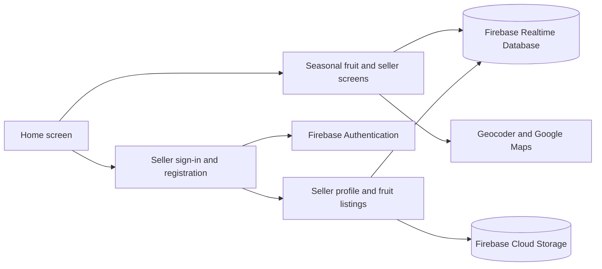

# FruitSeason

FruitSeason is an Android application for discovering fruits and finding sellers who list them. Buyers can browse a fruit catalog, filter it by season, and view seller information. Sellers can create an account, maintain a profile, and add catalog fruits to their own listings with a price.

This repository contains the Android client. Authentication, catalog and seller data, and image storage are provided by Firebase services configured for the app.

## Features

### Buyer experience

- Browse all fruits or filter the catalog to fruits marked as in season for the current month.  
- Search the catalog by fruit name.  
- View sellers who list a selected fruit and the price they entered, displayed as R\$/kg.  
- Open a seller's address on a map. The app resolves the profile address with Android's geocoder and displays a map marker.

### Seller experience

- Register and sign in with an email address and password.  
- Save a seller profile with a name, phone number, address, city, and province.  
- Browse the fruit catalog, set a price for a fruit, and review the seller's own listings.  
- Update profile information and a profile image.  
- Request a password reset email through Firebase Authentication.

## Technology

- Java and Android SDK  
- Android Gradle Plugin 8.2.1 and Gradle 8.2 wrapper  
- Firebase Authentication, Realtime Database, and Cloud Storage  
- Google Maps SDK for Android  
- AndroidX, Material Components, Picasso, and CircleImageView

The module is configured with `minSdk 24`, `targetSdk 34`, and `compileSdk 34`. Java source and target compatibility are set to Java 8\. Building with Android Gradle Plugin 8.x requires JDK 17; see the [Android JDK documentation](https://developer.android.com/build/jdks).

## Architecture

The app is organized around Android activities. Activities handle screens, navigation, and Firebase reads and writes. RecyclerView adapters render fruit, seller, and listing rows. Simple model classes map Firebase data to Java objects; helper classes handle permissions and RecyclerView item clicks.



&nbsp;

Firebase provides the backend services used directly by the Android client.

## Project structure

```
.
├── app/
│   ├── build.gradle.kts           # Android application and dependencies
│   ├── google-services.json       # Firebase client configuration
│   └── src/
│       ├── main/
│       │   ├── java/com/example/fruitseason/
│       │   │   ├── adapter/       # RecyclerView adapters
│       │   │   ├── helper/        # Permission and item-click helpers
│       │   │   ├── model/         # Fruit, seller, and listing models
│       │   │   └── *.java         # Activities
│       │   └── res/               # Layouts, strings, themes, and images
│       ├── test/                  # Local JVM tests
│       └── androidTest/           # Device or emulator tests
├── gradle/wrapper/                # Gradle wrapper
├── build.gradle.kts               # Root plugin configuration
└── settings.gradle.kts            # Gradle project settings
```

## Setup

### Requirements

- Android Studio with Android SDK Platform 34 installed  
- JDK 17 for the Gradle build  
- An Android device or emulator running API 24 or later  
- Internet access and a Firebase project configured for this application  
- Google Play services on the device or emulator for the map screen

### Firebase configuration

The app uses the package name `com.example.fruitseason`. Configure a Firebase Android app with that package name, then place its `google-services.json` file at `app/google-services.json`.

Enable Email/Password sign-in in Firebase Authentication, and configure Realtime Database and Cloud Storage. The app expects the following data paths:
